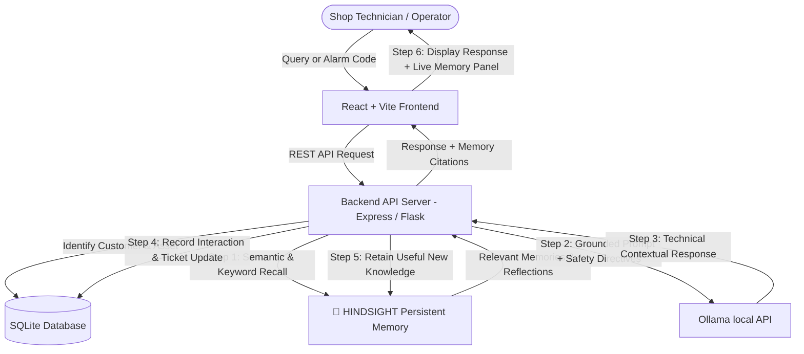

# SupportMind AI
### Memory-Powered Industrial Customer Support Agent

SupportMind AI is an intelligent customer support and diagnostics agent specialized for MSMEs (Micro, Small, and Medium Enterprises) and industrial equipment.

Unlike stateless chatbots that reset their context on every turn, SupportMind AI is powered by **HINDSIGHT**, a persistent, multi-session AI memory system. Every machine failure, symptom, error code, failed attempt, successful solution, and customer protocol is retained in long-term memory. When a customer or machine returns with a similar issue days or weeks later, SupportMind recalls historical precedents to deliver precise, contextual, and safe troubleshooting guidance.

---

## 1. Problem Statement & The Long-Term Memory Difference

Industrial maintenance across machine shops and manufacturing floors faces severe challenges:
- **Tribal Knowledge Loss:** When a night-shift technician replaces a seized fan motor or clears swarf from an intake filter, the next shift or service engineer often starts diagnosis from scratch.
- **Repetitive Downtime:** Machines repeatedly fail for known reasons, yet generic support bots ask the same questions repeatedly: *"What is the machine model? Have you plugged it in?"*
- **Dangerous Recommendations:** Industrial environments involve high voltage (480V), high hydraulic pressures (210 bar), and heavy mechanical crush zones. Support systems must recognize hazards and enforce Lockout/Tagout (LOTO) protocols.

### The SupportMind AI Evolution
- **Interaction 1:** Baseline diagnostic inquiry (no prior history exists).
- **Interaction 5:** Personalized troubleshooting referencing component-level records (e.g. *"Recalling Aug 12 fan replacement Part #CF-882"*).
- **Interaction 20:** Predictive mastery and pattern clustering (e.g. recognizing recurrent swarf clogs during 3-shift continuous cycles under high ambient summer temperatures).

---

## 2. Architecture & The Memory Loop



### Application Database vs. Long-Term AI Memory

| Feature | Application Database (SQLite) | Persistent AI Memory (Hindsight) |
| :--- | :--- | :--- |
| **Primary Role** | Relational records, ACID transactions, CRUD operations | Cognitive long-term memory, pattern synthesis, semantic recall |
| **Data Stored** | Customer tables, machine inventory, ticket rows, chat logs | Episodic failure events, procedural preferences, semantic machine facts |
| **Query Mechanism** | SQL `SELECT * WHERE customer_id = ?` | Semantic similarity, relevance ranking, synonym expansion, reflection |
| **Evolution** | Static data rows | Compounds in intelligence across sessions and interactions |

---

## 3. Technology Stack

- **Frontend:** React 19, Vite, Tailwind CSS, Lucide Icons, Axios, Motion
- **Backend Options:**
  - **Fullstack Runtime:** Node.js 22 + TypeScript + Express (integrated dev server with Vite middleware on port 3000)
  - **Python Backend:** Python 3.10+, Flask, Flask-CORS, requests
- **Database:** SQLite (`data/supportmind.db`)
- **AI Core:** Ollama (local model via Ollama API)
- **Memory Layer:** Hindsight Persistent Memory Engine (with official REST API integration and persistent local engine)

---

## 4. Key Features

1. **Autonomous Diagnostic Agent:** Specialized for CNC mills, hydraulic stamping presses, turning centers, and welding robotics.
2. **Persistent Hindsight Memory Panel:** Real-time visibility into recalled memories, category tags, event dates, and confidence ratings.
3. **Without Memory vs. With Hindsight (Side-by-Side):** Direct A/B comparison demonstrating how stateless LLMs fail versus how Hindsight accelerates resolution.
4. **Machine Incident & Resolution Timeline:** Chronological visual timeline for assets (e.g. `CNC-M102` Aug 12 fan replacement, Aug 29 vibration lubrication, Sep 15 swarf intake cleaning).
5. **Industrial Safety Interlocks:** Immediate Emergency Stop (E-Stop) and Lockout/Tagout (LOTO) protocols for electrical arc, smoke, fire, or high pressure.
6. **Reflection & Higher-Level Insights:** Pattern detection across multiple incidents to identify systemic bottlenecks.
7. **Demo Seeding & Reset:** Instant one-click generation of realistic synthetic industrial data.

---

## 5. Environment Variables Configuration

Create a `.env` file in the root directory (or `backend/.env` for the Flask server):

```env
# Local AI with Ollama (no API key required)
OLLAMA_BASE_URL="http://127.0.0.1:11434"\nOLLAMA_MODEL="llama3.2"

# Hindsight Persistent Memory API (Optional / Configurable)
# When set, SupportMind connects directly to your remote Hindsight instance
HINDSIGHT_API_URL="https://api.hindsight.ai"
HINDSIGHT_API_KEY="your-hindsight-key"

# Application URL
APP_URL="http://localhost:3000"
```

---

## 6. Installation & Quickstart

### Method A: Fullstack Dev Server (Node / Vite / Express)
The applet includes an Express server mounting Vite middlewares on port 3000:

```bash
# 1. Install dependencies
npm install

# 2. Run dev server
npm run dev

# App runs at http://localhost:3000
```

### Method B: Standalone Python Flask Backend
To run the dedicated Python Flask backend:

```bash
# 1. Navigate to backend directory
cd backend

# 2. Create virtual environment
python -m venv venv

# Windows:
venv\Scripts\activate
# Linux/macOS:
source venv/bin/activate

# 3. Install Python requirements
pip install -r requirements.txt

# 4. Start Flask server
python app.py
# Flask runs on http://localhost:5000
```

---

## 7. Database Schema

The SQLite database (`data/supportmind.db`) contains five core tables:

1. `customers` (customer_id, company_name, contact_name, email, phone, location, created_at)
2. `machines` (machine_id, customer_id, machine_name, model, manufacturer, location, installation_date, status, operating_environment)
3. `tickets` (ticket_id, customer_id, machine_id, issue, severity, status, created_at, resolved_at, resolution, outcome)
4. `interactions` (ticket_id, customer_id, machine_id, user_message, agent_response, created_at)
5. `hindsight_memories` (memory_id, customer_id, machine_id, memory_type, category, title, summary, details, confidence, event_date, created_at, tags)

---

## 8. Step-by-Step Hackathon Demonstration Guide

Follow this test flow to evaluate all features:

1. **Load Demo Data:** Click the **"Load Demo Data"** button in the header.
2. **Navigate to "Support Agent":**
   - Customer: `ACME Manufacturing (CUST-001)`
   - Machine: `CNC-M102 (DMG MORI 5-Axis Precision Mill)`
3. **Trigger the Memory Loop:**
   - Click the preset scenario: **"Machine M102 is overheating again."**
   - Observe the **Memory Used Indicator**: `🧠 4 relevant Hindsight memories recalled & applied`.
   - Inspect the **Memory Panel** on the right: see the Aug 12 fan replacement (Part #CF-882), Sep 15 swarf intake blockage, and Marcus Vance's step-by-step checklist preference.
4. **Test the "Memory Impact" A/B Comparison:**
   - Click the **"Memory Impact"** tab in navigation.
   - Run the side-by-side comparison for *"Machine M102 is overheating again."*
   - Notice the stark contrast:
     - **Without Hindsight:** Generic response asking for serial numbers and operating manuals.
     - **With Hindsight:** Immediately identifies the cooling fan and swarf filter history with 95%+ confidence.
5. **Test Industrial Safety Interlock:**
   - In chat, select preset **"Hazard Test: Smoke & Sparks"** (`There is smoke and burning smell coming from the main 480V control panel!`).
   - Observe the immediate critical safety interlock: E-Stop engagement, Lockout/Tagout (LOTO), and refusal to give DIY panel repair steps.
6. **Inspect the Machine Timeline:**
   - Navigate to **"Machines"** → click **"CNC-M102"**.
   - Review the chronological incident timeline with milestone outcomes.

---

## 9. API Reference

| Method | Endpoint | Description |
| :--- | :--- | :--- |
| `GET` | `/api/health` | Healthcheck and service connection status |
| `GET` | `/api/customers` | List all industrial customers |
| `GET` | `/api/machines` | List all monitored machines |
| `GET` | `/api/tickets` | List all support tickets |
| `POST` | `/api/chat` | Send diagnostic message; triggers Hindsight recall & retain |
| `POST` | `/api/chat/compare` | Run side-by-side Without vs With Hindsight comparison |
| `GET` | `/api/memory/:cust_id/:mach_id` | Retrieve Hindsight memories and reflection insights |
| `POST` | `/api/memory/retain` | Retain a new memory item into Hindsight |
| `POST` | `/api/demo/seed` | Seed synthetic demo baseline data |
| `POST` | `/api/demo/reset` | Reset database and memory store |

---

## 10. License

Apache-2.0 License. Built for the AI Agent Hackathon.
